# dinail AI — cek foto ukuran kuku

Layanan untuk UMKM press-on nails **dinail.co**: customer memotret tangannya bersama koin
sebagai patokan ukuran, lalu sistem memeriksa apakah fotonya layak, mendeteksi koin,
menghitung skala piksel→mm, dan menyarankan nomor ukuran memakai tabel konversi milik pemilik.

Bagian AI dari capstone **Asah 2026 (tim A26-CS222)**. Ini layanan backend (HTTP API) plus
satu halaman HTML untuk uji manual; halaman pemesanan, antrian admin, dan dashboard pemilik
dikerjakan tim FS dan memanggil endpoint di sini.

Prinsip yang dipegang: **hasil AI selalu saran**. Setiap respons membawa angka mentah
(piksel, mm, skor) supaya bisa diaudit, dan selalu `needs_admin_check: true` karena admin
yang mengonfirmasi pesanan.

## Masalah yang diselesaikan

Info desain dan ukuran dikumpulkan manual lewat chat, dan customer mengirim foto ukuran kuku
dengan patokan koin. Foto sering miring, buram, atau tanpa patokan, sehingga konfirmasi lama
dan ukuran berisiko meleset. Layanan ini menolak foto yang tidak layak **sejak awal** dengan
alasan yang bisa ditindaklanjuti, lalu memberi saran ukuran yang tetap dicek admin.

## Alur

```
foto tangan + koin
   │
   ├─ gerbang kualitas  → buram / gelap / kekecilan / koin tidak ada  → tolak + alasan
   ├─ deteksi koin      → Hough kasar → refine sub-piksel ke rim luar
   ├─ skala             → px/mm = diameter koin (px) / diameter resmi (mm)
   ├─ konversi          → lebar kuku (px) ÷ skala = mm
   └─ tabel pemilik     → nomor ukuran (S/M/L/…) atau "belum diisi"
```

## Struktur

| berkas | isi |
|---|---|
| `dinail_ai/coins.py` | tabel diameter koin rupiah + nominal yang ambigu (sumber + tahun) |
| `dinail_ai/quality.py` | metrik kualitas foto + `gate()` yang mengembalikan alasan tolak |
| `dinail_ai/detect.py` | Hough kasar → refine sub-piksel ke rim luar → gerbang coverage per kuadran → skor |
| `dinail_ai/sizes.py` | pemetaan lebar mm ke nomor ukuran dari tabel pemilik (atau "belum diisi") |
| `dinail_ai/analyze.py` | orkestrasi satu foto: kualitas → deteksi → skala → saran |
| `dinail_ai/app.py` | FastAPI: `/v1/analyze`, `/health`, `/v1/size-table`, halaman `/` |
| `scripts/make_fixtures.py` | pembuat scene uji ber-ground-truth + crop foto koin |
| `scripts/make_samples.py` | pembuat foto contoh + gambar anotasi hasil untuk README |
| `samples/` | foto contoh sintetis (`contoh-*.jpg`) dan gambar hasil anotasinya (`hasil-*.jpg`) |
| `samples/asli/` | foto asli pemilik (jempol + empat jari) dan hasil anotasinya |
| `samples/real/` | tiga foto tangan asli (CC BY 2.0) untuk uji negatif, plus atribusi |
| `tests/` | 46 uji: tabel koin, gerbang kualitas, deteksi & akurasi, tabel ukuran, orkestrasi, API |

## Jalankan

```bash
python3.12 -m venv venv          # python >=3.10; 3.9 tidak punya wheel numpy>=2.1
./venv/bin/pip install -r requirements.txt
./venv/bin/python scripts/make_fixtures.py   # fixture uji (sekali, ~10 s)
./venv/bin/python -m pytest -q               # 46 uji, ~35 s
./venv/bin/uvicorn dinail_ai.app:app --port 8000
```

Buka `http://localhost:8000` untuk halaman unggah, atau `http://localhost:8000/docs` untuk
Swagger.

## Contoh foto & hasil

Foto asli dari pemilik dinail.co (sampel berlabel S01): jempol dan empat jari dengan koin
Rp500 yang sama. EXIF dihapus dan tidak ada wajah atau nama di dalamnya; dipakai dengan izin
pemilik untuk capstone ini.

| masukan | hasil |
|---|---|
| 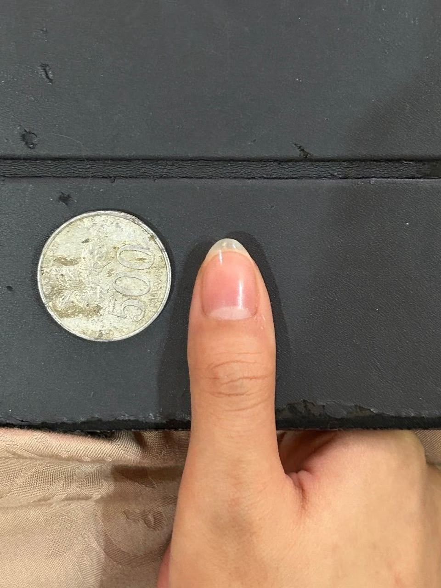 | 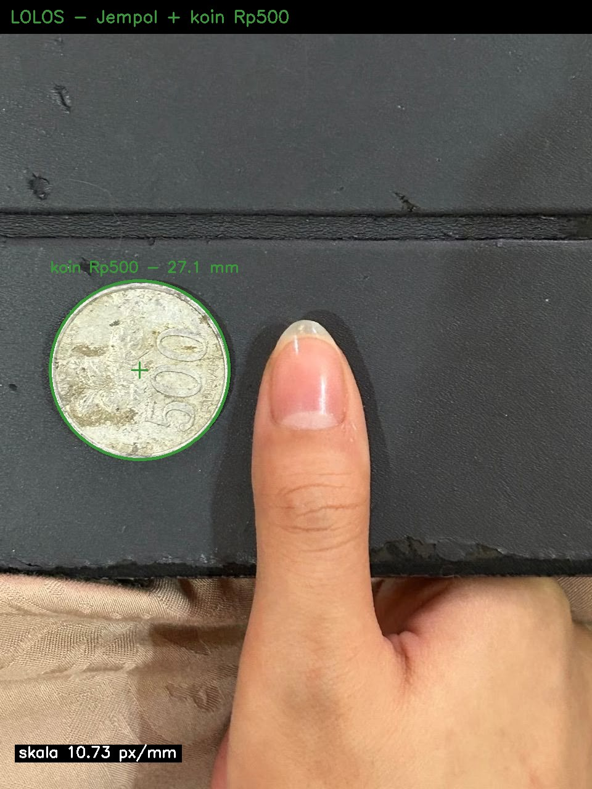 |
| 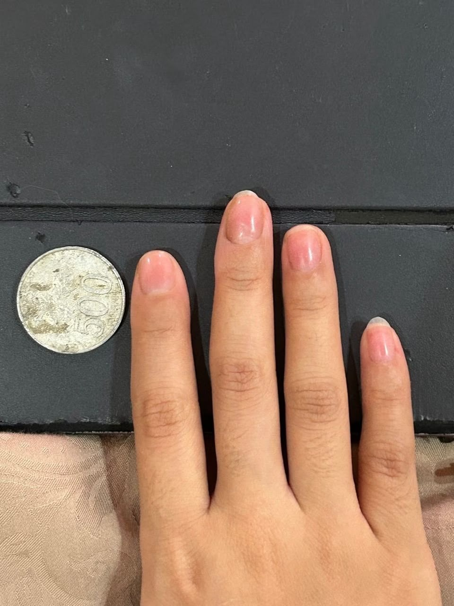 | 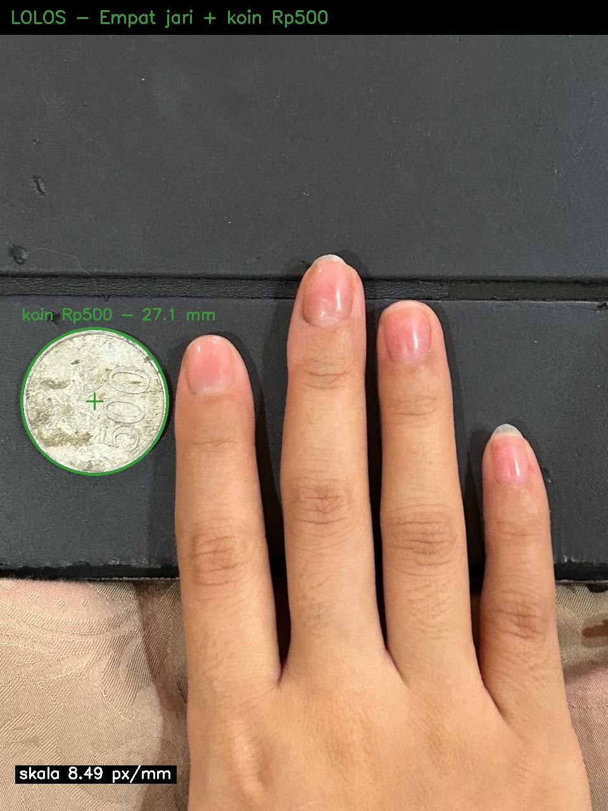 |

Skala yang keluar dibandingkan dengan ukur manual tim DS pada foto yang sama:

| foto | skala manual | skala layanan | selisih |
|---|---|---|---|
| `jempol-koin-500` | 10,57 px/mm | 10,77 px/mm | +1,8% |
| `empat-jari-koin-500` | 8,42 px/mm | 8,52 px/mm | +1,2% |

Layanan **belum** mengukur lebar kuku: yang digambar hanya lingkaran koin dan skala. Lebar
kuku masih dikirim UI/admin dalam piksel (lihat "Yang belum dikerjakan").

Uji negatif (tidak ditampilkan sebagai contoh): tiga foto tangan CC BY 2.0 di `samples/real/`
dipakai memastikan layanan menolak foto tanpa koin Rupiah yang layak. Dua ditolak; satu
(telapak dengan koin digenggam) masih lolos — batas yang diketahui, dijelaskan di bagian
"Hasil pada foto pemilik".

### Scene sintetis untuk uji geometri

Empat foto di `samples/contoh-*.jpg` **bukan foto customer** dan bukan kuku: koinnya digambar
pada radius pasti (tekstur dari foto koin domain publik) dan ada kotak pengganti kuku dengan
lebar pasti, supaya skala dan konversi mm bisa dihitung tanpa ambiguitas. Fungsinya menguji
geometri, bukan memperagakan kuku.

| masukan | hasil |
|---|---|
| 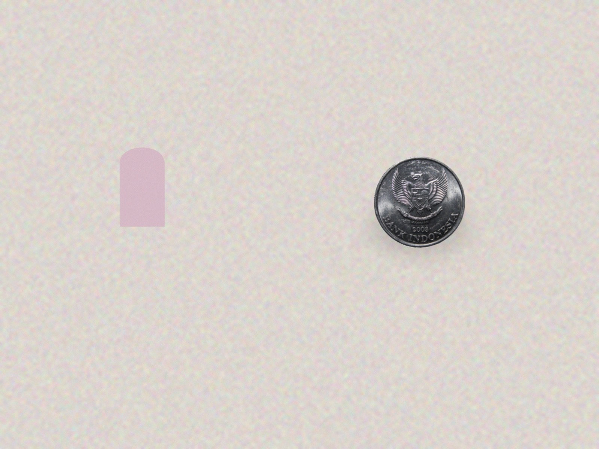 | 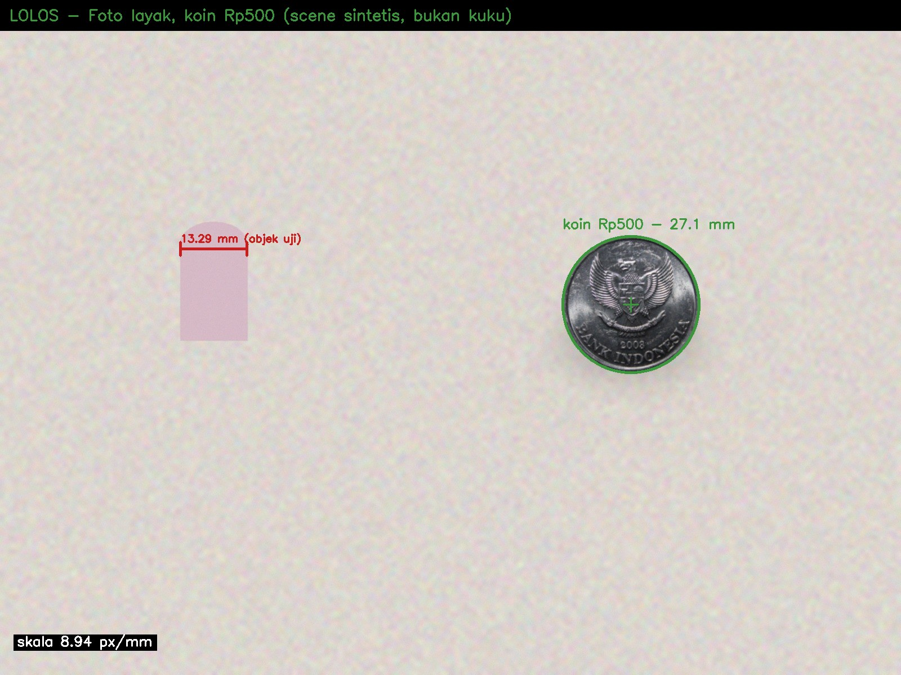 |
| 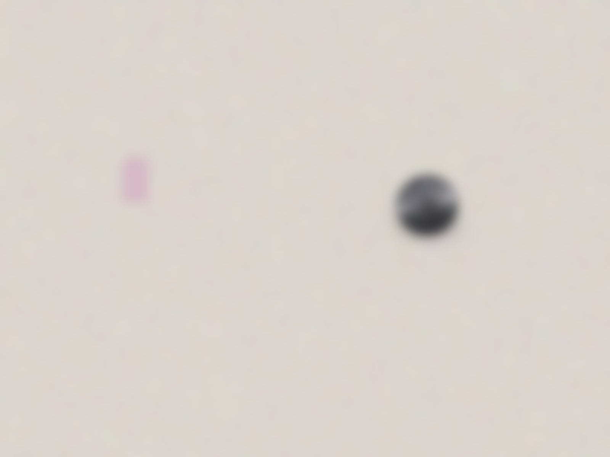 | 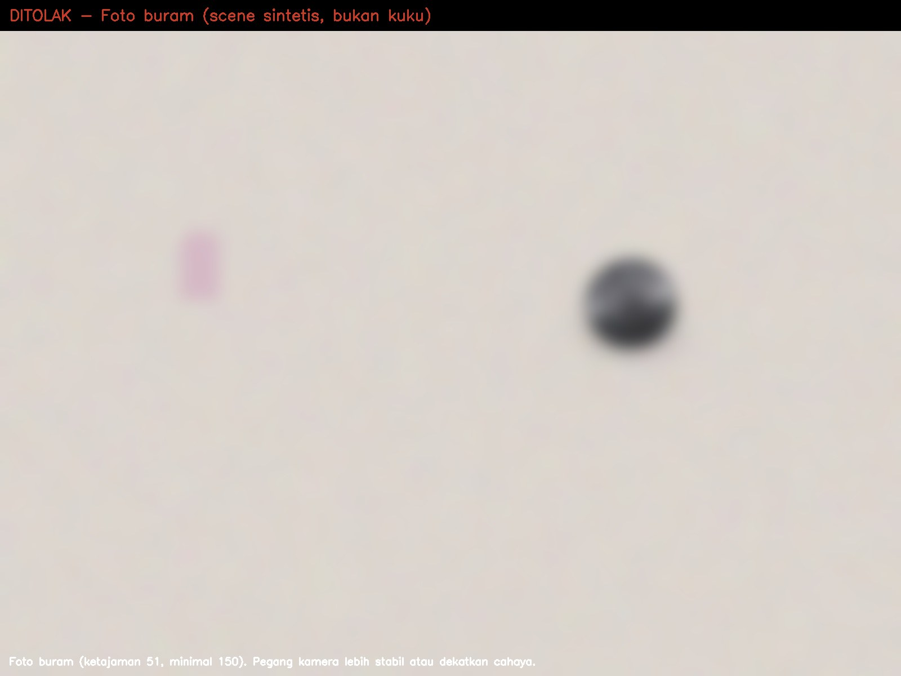 |
| 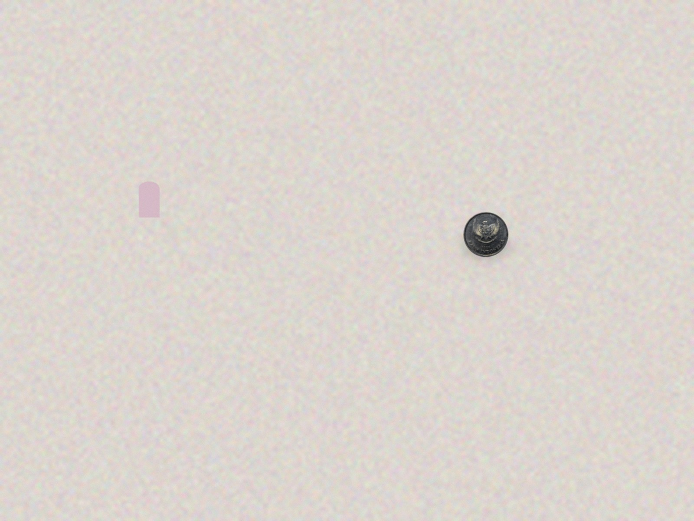 | 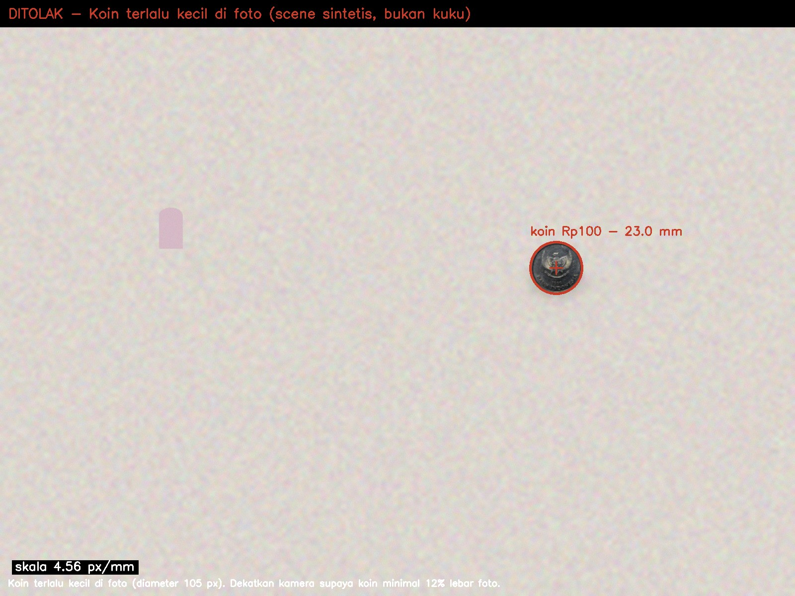 |
| 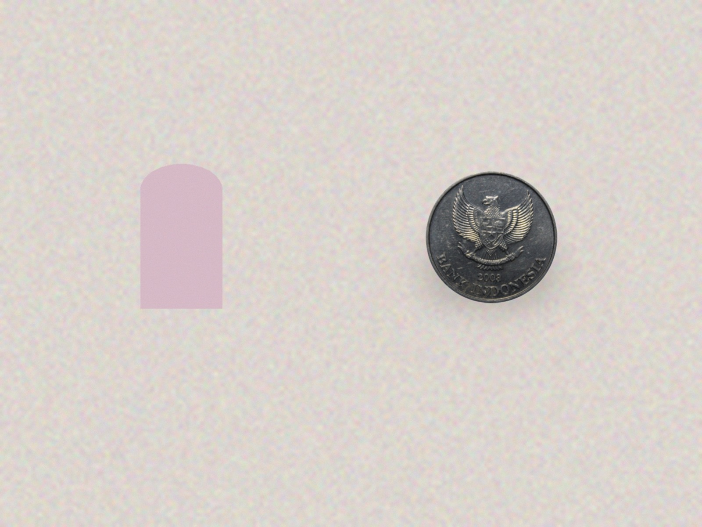 | 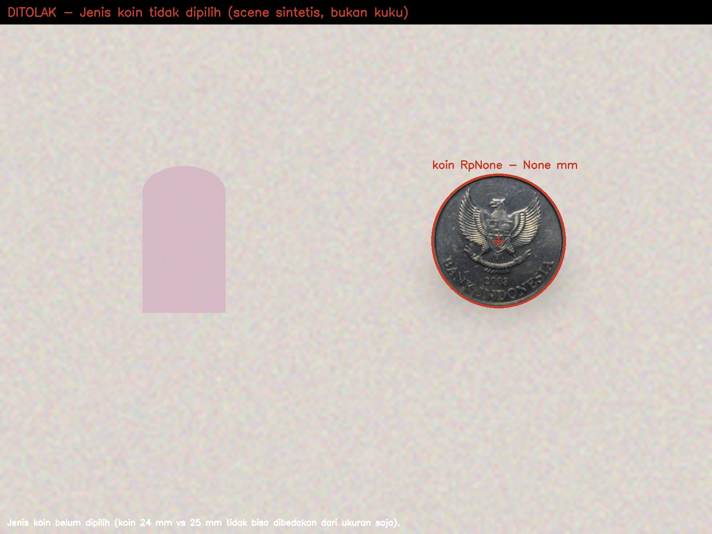 |

Pada gambar hasil, angka mm diberi label "objek uji", bukan "kuku", karena memang bukan kuku.

Gambar hasil dibuat oleh `scripts/make_samples.py` yang memanggil pipeline yang sama seperti
layanan, bukan ditulis tangan.

## Contoh input & output

### 1. Foto layak, koin Rp500

```bash
curl -X POST http://localhost:8000/v1/analyze \
  -F "image=@samples/contoh-01-layak.jpg;type=image/jpeg" \
  -F "coin=500" \
  -F "nail_width_px=118.8"
```

```json
{
  "ok": true,
  "quality": {
    "pass": true,
    "reasons": [],
    "width": 1600,
    "height": 1200,
    "min_side": 1200,
    "sharpness": 497.7,
    "sharpness_global": 201.4,
    "brightness": 211.05
  },
  "coin": {
    "found": true,
    "center_px": [
      1120.5,
      541.3
    ],
    "radius_px": 121.2,
    "diameter_px": 242.3,
    "score": 0.925,
    "alternatives": [],
    "type": "500",
    "diameter_mm": 27.1
  },
  "scale_px_per_mm": 8.9414,
  "nail": {
    "width_px": 118.8,
    "width_mm": 13.29,
    "suggestion": {
      "size": null,
      "reason": "tabel konversi ukuran pemilik belum diisi",
      "needs_admin_check": true
    }
  },
  "warnings": [],
  "elapsed_ms": 185.7
}
```

Fotonya asli 1600×1200 dengan koin 242,4 px; skala sebenarnya 9,0 px/mm, jadi error skala
0,65% dan lebar kuku 13,29 mm (sebenarnya 13,2 mm). `suggestion.size` masih `null` karena
tabel konversi pemilik belum diisi — layanan sengaja tidak menebak.

### 2. Foto buram

```bash
curl -X POST http://localhost:8000/v1/analyze \
  -F "image=@samples/contoh-02-buram.jpg;type=image/jpeg" -F "coin=500"
```

```json
{
  "ok": false,
  "quality": {
    "pass": false,
    "reasons": [
      "Foto buram (ketajaman 51, minimal 150). Pegang kamera lebih stabil atau dekatkan cahaya.",
      "Patokan koin tidak terdeteksi: letakkan koin datar di samping tangan."
    ],
    "width": 1600,
    "height": 1200,
    "min_side": 1200,
    "sharpness": 51.3,
    "sharpness_global": 31.1,
    "brightness": 212.93
  },
  "coin": null,
  "scale_px_per_mm": null,
  "nail": null,
  "warnings": [],
  "elapsed_ms": 53.1
}
```

### 3. Koin kekecilan di frame

```bash
curl -X POST http://localhost:8000/v1/analyze \
  -F "image=@samples/contoh-03-koin-kecil.jpg;type=image/jpeg" -F "coin=100"
```

```json
{
  "ok": false,
  "quality": {
    "pass": false,
    "reasons": [
      "Koin terlalu kecil di foto (diameter 105 px). Dekatkan kamera supaya koin minimal 12% lebar foto."
    ],
    "width": 1600,
    "height": 1200,
    "min_side": 1200,
    "sharpness": 494.7,
    "sharpness_global": 26.9,
    "brightness": 213.75
  },
  "coin": {
    "found": true,
    "center_px": [
      1119.7,
      539.9
    ],
    "radius_px": 52.4,
    "diameter_px": 104.9,
    "score": 0.987,
    "alternatives": [],
    "type": "100",
    "diameter_mm": 23.0
  },
  "scale_px_per_mm": 4.5607,
  "nail": null,
  "warnings": [],
  "elapsed_ms": 89.2
}
```

Koin tetap terdeteksi dan skalanya dihitung; yang menolak adalah gerbang kualitas, karena
pada 4,5 px/mm satu piksel galat tepi sudah setara sepersekian nomor ukuran.

### 4. Jenis koin tidak dipilih

```bash
curl -X POST http://localhost:8000/v1/analyze \
  -F "image=@samples/contoh-04-tanpa-jenis-koin.jpg;type=image/jpeg" -F "nail_width_px=186"
```

```json
{
  "ok": false,
  "quality": {
    "pass": false,
    "reasons": [
      "Jenis koin belum dipilih (koin 24 mm vs 25 mm tidak bisa dibedakan dari ukuran saja).",
      "Lebar kuku tidak bisa dikonversi ke mm tanpa skala koin."
    ],
    "width": 1600,
    "height": 1200,
    "min_side": 1200,
    "sharpness": 461.8,
    "sharpness_global": 222.2,
    "brightness": 208.79
  },
  "coin": {
    "found": true,
    "center_px": [
      1120.2,
      541.7
    ],
    "radius_px": 149.5,
    "diameter_px": 298.9,
    "score": 0.887,
    "alternatives": []
  },
  "scale_px_per_mm": null,
  "nail": null,
  "warnings": [],
  "elapsed_ms": 123.8
}
```

Rp200 (25 mm) dan Rp1000 (24 mm) hanya beda 1 mm, jadi jenis koin wajib dipilih di form,
bukan ditebak dari ukuran. Kalau valuenya di luar daftar:

```json
{"ok": false,
 "quality": {"pass": false,
   "reasons": ["Jenis koin tidak dikenal: '2000'. Pilih Rp50, Rp100, Rp200, Rp500, atau Rp1000."]}}
```

### 5. Setelah tabel konversi pemilik diisi

Tabel diletakkan di `dinail_ai/size_table.json` (lihat `size_table.example.json`):

```json
{
  "source": "pemilik dinail.co",
  "updated_at": "2026-11-08",
  "sizes": [
    {"size": "S", "min_mm": 12.6, "max_mm": 14.0},
    {"size": "M", "min_mm": 14.1, "max_mm": 15.5}
  ]
}
```

Dengan tabel itu, foto contoh nomor 1 menghasilkan:

```json
"nail": {
  "width_px": 118.8,
  "width_mm": 13.23,
  "suggestion": {
    "size": "S",
    "range_mm": [12.6, 14.0],
    "margin_mm": 0.63,
    "ambiguous": false,
    "needs_admin_check": true
  }
}
```

`ambiguous: true` muncul kalau lebar kuku berada kurang dari 0,5 mm dari batas nomor ukuran,
supaya admin melihat kasus yang rawan salah.

### 6. Status layanan

```bash
curl http://localhost:8000/health
curl http://localhost:8000/v1/size-table
```

```json
{"status": "ok", "version": "0.1.0",
 "coins": {"50": 20.0, "100": 23.0, "200": 25.0, "500": 27.0, "1000": 24.0},
 "size_table_configured": false,
 "size_table_path": "/app/dinail_ai/size_table.json"}

{"configured": false, "sizes": [],
 "note": "tabel konversi nomor ukuran dari pemilik belum diisi"}
```

### Galat input

| kondisi | status | isi |
|---|---|---|
| tipe file bukan gambar | `415` | `Tipe file text/plain tidak didukung; kirim JPEG/PNG/WebP.` |
| file kosong | `400` | `File kosong.` |
| file > 12 MB | `413` | `Foto lebih dari 12 MB, perkecil dulu.` |
| bytes gambar rusak | `422` | `File bukan gambar yang bisa dibaca (JPEG/PNG/WebP).` |

## Hasil pada foto pemilik

Paket data pemilik: 32 foto (16 grup, jempol dan empat jari) + `metadata_foto.csv` berisi pusat
dan diameter koin tiap foto hasil ukur manual tim DS. Foto **tidak ada di repo** (tangan
pelanggan), jadi evaluasi dijalankan lokal:

```bash
python scripts/eval_real.py --data-dir ~/Downloads/dinail_data_siap_pakai --out eval
```

Hasil terakhir (32 foto, koin Rp500/Rp1000, gerbang coverage ≥ 0,25):

| metrik | nilai |
|---|---|
| koin terdeteksi | **31/32** (96,9%) |
| selisih diameter koin, median | **2,3%** |
| selisih diameter, p90 | 6,2% |
| selisih terburuk | 22,7% (foto buram, `status_kualitas_awal = perlu_cek`) |
| dalam 2% | 15 dari 31 |

Selisih 2,3% pada koin 27 mm = 0,6 mm; pada lebar kuku 13 mm itu 0,3 mm, di bawah satu nomor
ukuran. Deteksi koin memakai `HOUGH_GRADIENT_ALT` (75–110 ms per foto) — versi `HOUGH_GRADIENT`
biasa butuh 16–139 detik untuk foto yang sama dan hasilnya lebih sering salah.

**Batas yang diketahui:** pada satu dari tiga foto tangan uji (`samples/real/tangan-koin-emas.jpg`)
busur telapak masih lolos sebagai "koin" (skor 0,72). Ambang gerbang sengaja diturunkan supaya
koin pada foto pemilik benar-benar ketemu; kalau dinaikkan ke 0,60 hanya 17/32 foto pemilik yang
lolos. Mitigasinya: hasil selalu saran dan admin tetap mengonfirmasi. Test
`test_known_limitation_palm_can_look_like_a_coin` menjaga batas ini tetap tercatat.

Yang **belum** terukur: ukuran kuku dalam mm terhadap penggaris. `metadata_foto.csv` hanya
memuat geometri koin, dan `tabel_ukuran_tip_ISI_PEMILIK.csv` masih kosong.

## Kontrak API

`POST /v1/analyze` — `multipart/form-data`

| field | wajib | isi |
|---|---|---|
| `image` | ya | JPEG/PNG/WebP, maks 12 MB |
| `coin` | tidak | `50` \| `100` \| `200` \| `500` \| `1000` (jenis koin yang dipakai) |
| `nail_width_px` | tidak | lebar kuku dalam piksel dari alat ukur di UI/admin |
| `coin_diameter_px` | tidak | jalur admin: diameter koin diukur manual kalau deteksi gagal |

Field respons: `ok`, `quality{pass, reasons, metrik}`, `coin{found, center_px, radius_px,
diameter_px, score, type, diameter_mm, alternatives}`, `scale_px_per_mm`, `nail{width_px,
width_mm, suggestion}`, `warnings[]`, `elapsed_ms`.

- `quality.pass = false` → tampilkan `quality.reasons` apa adanya ke customer.
- `suggestion.size = null` → tabel konversi pemilik belum diisi; jangan menebak.
- Latensi terukur (foto 1600×1200): 47 ms saat ditolak cepat, 106 ms saat analisis penuh di
  laptop M-series; foto tangan asli 134 ms. Di sandbox 4 vCPU, kalikan kira-kira dua.

## Data yang dipakai

Diameter koin (sumber: Wikipedia "Uang koin rupiah"; perlu dikonfirmasi ke pemilik):

| Nominal | Diameter dipakai | Per seri (tabel pemilik) | Tebal | Berat |
|---|---|---|---|---|
| Rp50 | 20,00 mm | — | 2,00 mm | 1,36 g |
| Rp100 | 23,00 mm | TE2016 23,00 | 2,00 mm | 1,79 g |
| Rp200 | 25,00 mm | TE2003 25,00 · TE2016 25,00 | 2,20 mm | 2,38 g |
| Rp500 | 27,10 mm | TE2003 27,00 · TE2016 27,20 | 2,35 mm | 3,10 g |
| Rp1000 | 24,10 mm | TE2016 24,10 | 1,45 mm | 4,50 g |

Sumber: `referensi_diameter_koin.csv` dari paket data pemilik (Peraturan BI), bukan Wikipedia.
Rp500 dipakai 27,10 mm karena emisi sering tidak terbaca di foto; seri yang pasti disimpan di
`SERIES` untuk pemakaian yang lebih teliti.

Ambang gerbang kualitas (`dinail_ai/quality.py`):

| pemeriksaan | ambang | catatan |
|---|---|---|
| resolusi | sisi pendek ≥ 700 px | di bawah ini 1 px galat tepi = satu nomor ukuran |
| ketajaman | ≥ 150 | p99,5 gradien per petak 128 px, diambil petak terajam |
| kecerahan | 45–235 | rata-rata kanal abu |
| koin ada | terdeteksi | radius mulai 3,5% sisi pendek |
| koin cukup besar | diameter ≥ 12% sisi pendek | putuskan skala masih layak atau tidak |

Akurasi **geometri** pada 6 scene sintetis ber-ground-truth (`fixtures/ground_truth.json`).
Ground truth dibangun dengan menggambar koin pada radius pasti, bukan diukur dengan detektor
yang sama. Ini bukan akurasi pada foto asli — lihat bagian "Uji dengan foto asli":

| file | koin | skala asli | terdeteksi | error | lebar asli | terdeteksi | error | vonis |
|---|---|---|---|---|---|---|---|---|
| g1_500 | Rp500 | 6,0 px/mm | 5,966 | 0,57% | 11,5 mm | 11,57 mm | 0,07 mm | lolos |
| g2_500 | Rp500 | 9,0 px/mm | 8,941 | 0,65% | 13,2 mm | 13,29 mm | 0,09 mm | lolos |
| g3_1000 | Rp1000 | 7,5 px/mm | 7,436 | 0,85% | 14,0 mm | 14,12 mm | 0,12 mm | lolos |
| g4_200 | Rp200 | 12,0 px/mm | 11,958 | 0,35% | 15,5 mm | 15,55 mm | 0,05 mm | lolos |
| g5_100 | Rp100 | 4,5 px/mm | 4,561 | 1,35% | 10,4 mm | 10,26 mm | 0,14 mm | ditolak (koin 105 px) |
| g6_1000 | Rp1000 | 14,0 px/mm | 13,822 | 1,27% | 16,8 mm | 17,02 mm | 0,22 mm | lolos |

Angka ini mengukur **geometri dan gerbangnya**, bukan akurasi pada foto pelanggan dinail.co:
untuk itu perlu foto berlabel dari pemilik plus penggaris sebagai pembanding.

Ketajaman sengaja tidak memakai varians Laplacian: pada foto berlatar polos (meja bersih +
satu koin tajam) variansnya jatuh ke 22–48 walau tepinya tajam, sehingga foto bagus ikut
ditolak. Versi per petak memberi 380–510 untuk foto yang sama, sedangkan foto buram tetap
51–55 di semua petak.

## Yang belum dikerjakan

- **Segmentasi kuku otomatis.** Lebar kuku masih dikirim UI/admin dalam piksel; scaling-nya
  sudah benar, deteksi kukunya belum.
- **Klasifikasi jenis koin dari gambar.** Jenis koin dipilih di form (jalur cadangan yang
  memang sudah direncanakan di dokumen risiko proyek).
- **Akurasi pada foto dinail.co.** Butuh 32 foto (16 sesi) + 50–100 foto berlabel pemilik.
- **Tabel konversi nomor ukuran.** Belum diserahkan pemilik; selama kosong, saran ukuran
  berhenti di milimeter.

## Lisensi data uji

- Foto koin di `fixtures/` dan `samples/koin/`: Wikimedia Commons, domain publik.
- Foto tangan di `samples/real/`: CC BY 2.0, atribusi di `samples/real/ATTRIBUTION.md`.
- Foto di `samples/asli/`: milik dinail.co, dipakai dengan izin pemilik untuk capstone
  A26-CS222. EXIF dihapus; tidak ada wajah, nama, atau nomor pesanan di dalamnya.
- Data penjualan (828 transaksi) dan 32 foto mentah pemilik tidak ada di repo ini.
